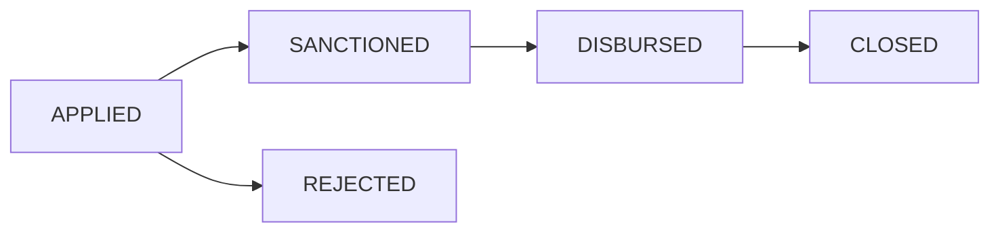

# Architecture

`User` contains account identity and a bcrypt hash. `ApplicationDraft` stores one borrower's editable details, eligibility outcome, and private salary-slip metadata. `Loan` captures an immutable application snapshot, financial terms, status timestamps, and embedded payments. This separation prevents a later draft edit from changing an already submitted application.

The API issues a signed JWT in an HTTP-only SameSite=Lax cookie. On each protected request it verifies the token, loads the current user, and checks the database role. Borrower loan reads also filter by borrower ID. Sanction and document reads require APPLIED status; disbursement detail requires SANCTIONED status; collection detail permits DISBURSED or CLOSED. Mutations require the configured frontend origin when the browser sends an Origin header. The frontend rechecks the session when the tab becomes visible and hides protected content after a 401.

Eligibility is a pure shared function called after saving details and again before submission. Money is stored as integer paise. Interest is `round(principalPaise * 12 * tenureDays / 36500)`, with `Math.round` to the nearest paisa. The server recomputes terms from allowed borrower inputs.

A partial unique index on `(borrowerId)` for active statuses prevents concurrent duplicate applications. A unique multikey index on `payments.utr` prevents a UTR appearing on different loans. The payment update also requires `payments.utr != UTR` to prevent same-document duplicates. Its aggregation update atomically appends the payment, increments the balance, and closes the loan at exact repayment. A conditional `$expr` blocks concurrent overpayment. No separate payment/loan writes can partially commit.

Uploads are content-signature checked and written under `apps/api/storage` with random UUID names. Submission checks the saved file's existence, size, and signature again. Download routes enforce borrower ownership or an applied-loan Sanction role and send `Cache-Control: no-store`. The API is divided into authentication, borrower, and operations routes with shared HTTP and storage helpers. Local files are suitable for the assignment demo, but a multi-instance production deployment needs private object storage.
